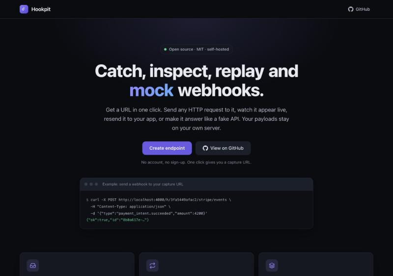
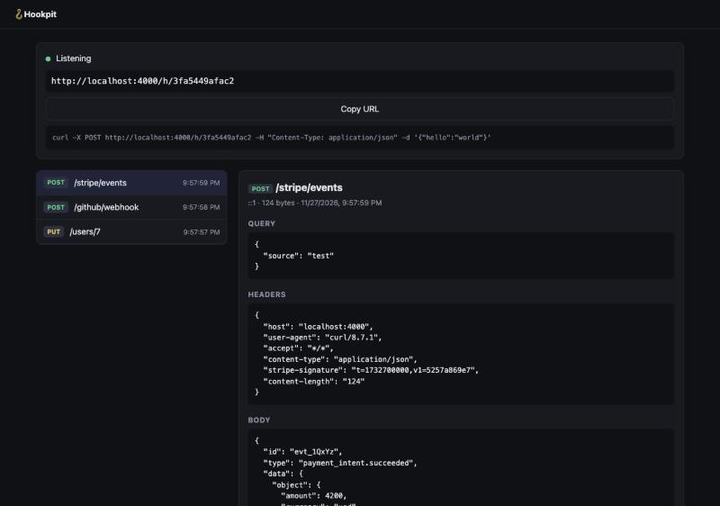
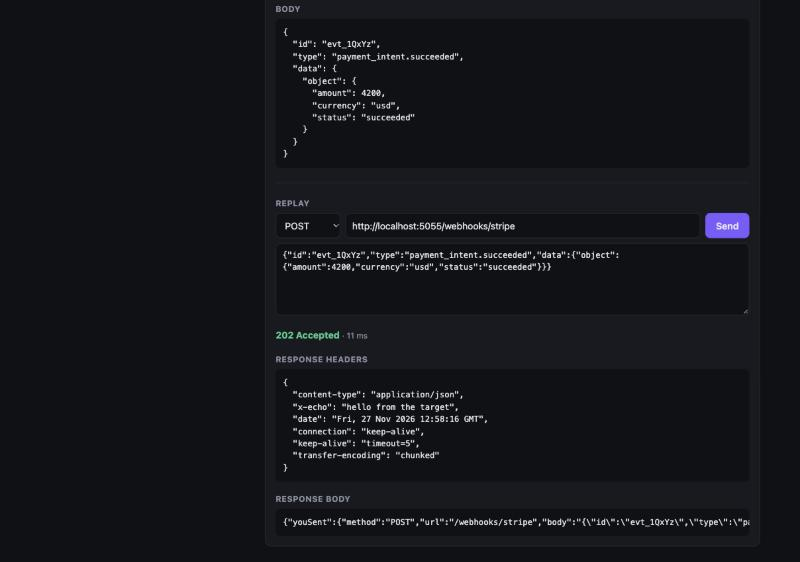
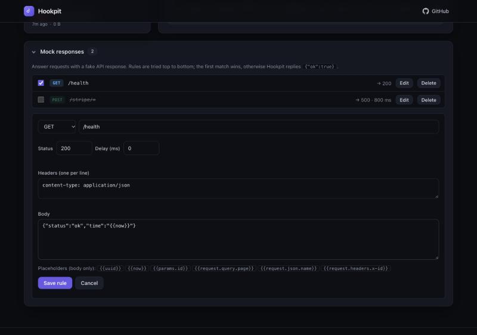

# 🪝 Hookpit

[](https://github.com/Aliweb789/hookpit/actions/workflows/ci.yml)
[](LICENSE)

**A self-hostable webhook inspector.** Get a URL in one click, point Stripe / GitHub / your own code at it, and watch every request appear live, with its exact method, headers, query and raw body.

Your payloads stay on your own server instead of a third-party site.

> **Status: early (v0.1).** Capture, live inspection, replay and mock responses work today. Signature checks are on the [roadmap](#roadmap). Contributions are very welcome.

## Demo



**1. Catch.** Point any service at your capture URL. Every request shows up live with its exact method, path, query, headers and raw body.



**2. Replay.** Fixed your handler? Resend the same request to your app, optionally editing the method or body first, and see exactly how it responded.



**3. Mock.** Make the capture URL answer like a real API: set the status, headers, a body with placeholders such as `{{now}}`, and a delay.



The interface follows your system's light or dark theme.

Try it in 30 seconds, once Hookpit is running (see [Quick start](#quick-start)):

```bash
# 1. create an endpoint in the dashboard at http://localhost:3000, then
# 2. send it anything:
curl -X POST http://localhost:4000/h/<your-slug>/stripe/events \
  -H "Content-Type: application/json" \
  -d '{"type":"payment_intent.succeeded","data":{"object":{"amount":4200}}}'
# 3. watch it appear, click it, and press Replay
```

## Features

- ✅ Unique capture URL per endpoint (`/h/<slug>`), any HTTP method and sub-path
- ✅ **Raw body preserved byte-for-byte**, not re-serialized (important for signature checks)
- ✅ Live dashboard: new requests appear instantly over Server-Sent Events
- ✅ **Replay** any captured request to a URL of your choice, editing the method and body first
- ✅ **Mock responses:** make a capture URL behave like a fake API (status, headers, body with placeholders, delay)
- ✅ Persistent history in SQLite, a single file with no database server to run
- ✅ MIT licensed

## Quick start

### With Docker (recommended)

```bash
git clone https://github.com/Aliweb789/hookpit.git
cd hookpit
docker compose up --build
```

Open <http://localhost:3000>, click **Create endpoint**, then send it a request:

```bash
curl -X POST http://localhost:4000/h/<your-slug> \
  -H "Content-Type: application/json" \
  -d '{"hello":"world"}'
```

> Tested on macOS (Apple Silicon) with Docker Desktop. Running it elsewhere (Linux, Windows, Intel)? Please tell us how it went in [this issue](../../issues/8), and [open an issue](../../issues) if something breaks.

Hosting on a real domain? Set the API address your *browser* will use:

```bash
HOOKPIT_PUBLIC_API_URL=https://hooks.example.com docker compose up --build
```

### Without Docker (development)

Requires Node.js 20+.

```bash
npm install
npm run build -w apps/api
npm run start -w apps/api      # API on http://localhost:4000
npm run dev:web                # dashboard on http://localhost:3000 (second terminal)
```

## How it works

```
Stripe / GitHub / curl ──HTTP──►  API (NestJS)  ──►  SQLite file
                                      │
                                      └── Server-Sent Events ──►  Dashboard (Next.js)
```

| Folder | What it is |
|---|---|
| `apps/api` | NestJS server: creates endpoints, captures requests, stores them, streams them live |
| `apps/web` | Next.js dashboard: create an endpoint and watch requests arrive |

## API

| Method | Path | Purpose |
|---|---|---|
| `POST` | `/api/endpoints` | Create an endpoint, returns `{ slug, createdAt }` |
| `GET` | `/api/endpoints/:slug/requests` | List captured requests (newest first) |
| `GET` | `/api/endpoints/:slug/stream` | Live stream of new requests (SSE) |
| `POST` | `/api/endpoints/:slug/requests/:id/replay` | Resend a captured request. JSON body: `{ "url": "...", "method"?, "headers"?, "body"? }`. Returns the target's `status`, `headers`, `body`, `durationMs` |
| `GET` `POST` | `/api/endpoints/:slug/mocks` | List or create mock rules |
| `PUT` `DELETE` | `/api/endpoints/:slug/mocks/:id` | Replace or delete a mock rule |
| `ANY` | `/h/:slug[/anything]` | **The capture URL.** Accepts any method and path, and answers with a matching mock rule if there is one |

## Mock responses

By default a capture URL answers `{"ok":true,"id":"..."}`. Add **mock rules** (the *Mock responses* panel on the endpoint page, or the API) to make it behave like a real API, so a frontend can be built before the backend exists, or so you can rehearse failures such as `500`, `429` or a slow reply.

A rule has a **method** (or any), a **path pattern**, a **status**, **headers**, a **body** and an optional **delay**. Rules are tried top to bottom and the first match wins. If none match, the default reply is sent. The request is always captured, mocked or not.

| Path pattern | Matches |
|---|---|
| `/users` | exactly `/users` (trailing slashes are ignored) |
| `/users/:id` | `/users/42` and captures `id=42` |
| `/files/*` | `/files`, `/files/a`, `/files/a/b/c` (`*` must be the last segment) |

The body can use placeholders, filled in for every request:

| Placeholder | Value |
|---|---|
| `{{uuid}}`, `{{now}}`, `{{timestamp}}` | a fresh UUID, ISO time, epoch milliseconds |
| `{{params.id}}` | a `:param` from the path pattern |
| `{{request.method}}`, `{{request.path}}` | the incoming method and path |
| `{{request.query.page}}` | a query-string value |
| `{{request.headers.x-signature}}` | a request header (lowercase name) |
| `{{request.body}}` | the raw request body |
| `{{request.json.user.id}}` | a field of the request body when it is JSON |

Missing values render as an empty string. Placeholders are plain lookups: there is **no code execution**.

```bash
# a rule: GET /users/:id -> 200 {"id":"{{params.id}}","token":"{{uuid}}"}
curl -X POST http://localhost:4000/api/endpoints/<slug>/mocks \
  -H "Content-Type: application/json" \
  -d '{"method":"GET","path":"/users/:id","status":200,
       "headers":{"Content-Type":"application/json"},
       "body":"{\"id\":\"{{params.id}}\",\"token\":\"{{uuid}}\"}","delayMs":300}'

curl http://localhost:4000/h/<slug>/users/42
# {"id":"42","token":"9b1d..."}
```

**Binary bodies.** To mock an image, a PDF, a protobuf message or any other binary response, set `"bodyEncoding": "base64"` (the *Encoding* choice in the panel) and put the base64 of the bytes in `body`. The body is decoded and sent byte for byte; placeholders are **not** filled in. Set a `Content-Type` header, otherwise `application/octet-stream` is used. The default, `"text"`, behaves as described above.

```bash
curl -X POST http://localhost:4000/api/endpoints/<slug>/mocks \
  -H "Content-Type: application/json" \
  -d "{\"path\":\"/logo.png\",\"headers\":{\"Content-Type\":\"image/png\"},
       \"bodyEncoding\":\"base64\",\"body\":\"$(base64 -w0 logo.png)\"}"
```

**Safety.** Mocks let users make your server send arbitrary content, so: every mock response carries `X-Content-Type-Options: nosniff` and `Content-Security-Policy: sandbox` (HTML or scripts cannot run on your origin); only the body is templated, never headers, so request data cannot inject headers; `Set-Cookie`, connection-level and security headers cannot be set; delay is capped at 10 s, bodies at 256 KB (after decoding, for base64 bodies) and rules at 50 per endpoint. Responses include an `X-Hookpit-Mock` header with the matching rule's id.

## Replay and security

Replay makes the **Hookpit server** call a URL you provide. On a server that is reachable by other people, that is a classic [SSRF](https://owasp.org/www-community/attacks/Server_Side_Request_Forgery) risk (reaching cloud metadata services, databases or admin panels on the private network), so replay is **safe by default**:

- only `http` and `https`, no credentials in the URL
- loopback, private, link-local (e.g. `169.254.169.254`) and other reserved addresses are **blocked**, including IPv6 and IPv4-mapped forms, checked at DNS-lookup time so DNS rebinding does not work
- redirects are never followed; 10 second timeout; responses are capped at 1 MB

Running Hookpit privately and want to replay to `localhost` or your LAN? Opt in:

| Variable | Default | Meaning |
|---|---|---|
| `HOOKPIT_ALLOW_PRIVATE_TARGETS` | `false` | `true` lets replay reach private and loopback addresses. **Only enable on an instance you do not expose publicly.** |
| `HOOKPIT_REPLAY_TIMEOUT_MS` | `10000` | How long to wait for the target |

```bash
# without Docker
HOOKPIT_ALLOW_PRIVATE_TARGETS=true npm run start -w apps/api

# with Docker (inside a container, "localhost" is the container itself;
# use http://host.docker.internal:3000/... to reach your machine)
HOOKPIT_ALLOW_PRIVATE_TARGETS=true docker compose up --build
```

## Rate limiting

Replay and capture are rate limited per client IP (capture also per endpoint slug). This is basic protection against abuse of a public instance, not a complete one: creating endpoints is not limited yet, so a client can still spread requests over many endpoints ([#24](../../issues/24)). Over the limit the API answers `429 Too Many Requests` with a `Retry-After` header (seconds). Counters are kept in memory, so each instance counts on its own.

| Variable | Default | Meaning |
|---|---|---|
| `HOOKPIT_REPLAY_RATE_LIMIT` | `30` | Replays per client IP per window. `0` turns the limit off. |
| `HOOKPIT_CAPTURE_RATE_LIMIT` | `600` | Captured requests per endpoint slug and client IP per window. `0` turns the limit off. |
| `HOOKPIT_RATE_WINDOW_MS` | `60000` | Window length in milliseconds. |
| `HOOKPIT_TRUST_PROXY` | unset | Behind a reverse proxy, set to the number of proxy hops (for example `1`) or `true` so the client IP is read from `X-Forwarded-For`. Without it every client behind the proxy shares the proxy's IP. |

Known limitations: there is no authentication yet (anyone who knows an endpoint slug and request id can replay it), and bodies are stored as UTF-8 text so binary payloads may not replay byte-for-byte. See the roadmap.

## Roadmap

- [x] Replay a captured request to any URL, editing it first
- [ ] Authentication and per-endpoint access control
- [ ] Faithful replay of binary bodies
- [x] Mock responses (custom status, body, headers, delay per path)
- [ ] Reorder mock rules, and show in the dashboard which rule answered a request
- [ ] Signature verification (Stripe, GitHub, Slack)
- [ ] OpenAPI import to generate mock endpoints
- [ ] CLI that forwards requests to `localhost` (`npx hookpit listen 3000`)
- [x] Basic rate limiting for replay and capture
- [ ] Rate limit endpoint creation, and automatic expiry of old data on public instances
- [x] CI (build on every pull request)
- [x] Automated tests for the API (unit and end-to-end; dashboard tests still welcome)

## Contributing

New here? Great. See [CONTRIBUTING.md](CONTRIBUTING.md) for setup and the PR workflow, and look for issues labelled **good first issue**.

## License

[MIT](LICENSE)
